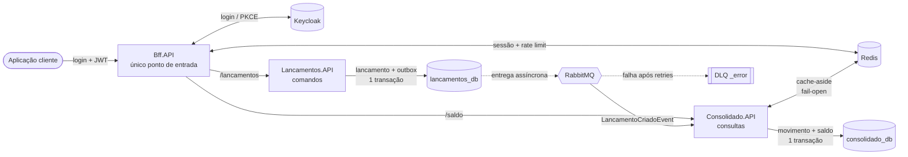

# Verx Finance — Movimentações e Saldo Consolidado

Solução para um banco digital registrar **movimentações financeiras** (créditos e débitos por conta) e consultar a
**posição consolidada** de uma conta, inclusive **em um instante passado**, mantendo-se confiável sob instabilidade,
alta demanda e falhas parciais.

> .NET 10 · C# · PostgreSQL · RabbitMQ (MassTransit) · Redis · Keycloak · OpenTelemetry · Docker Compose

### Documentação rápida

| | |
|---|---|
| 🧭 **Índice da documentação** | [`docs/`](docs/README.md) |
| 🏛️ **Arquitetura** (fluxos, modos de falha, requisitos não funcionais, ameaças) | [`docs/arquitetura.md`](docs/arquitetura.md) |
| 🗺️ **Diagramas C4** (Mermaid) | [Contexto e containers (níveis 1 e 2)](docs/c4/01-contexto-e-containers.md) · [Componentes (nível 3)](docs/c4/02-componentes.md) · [Structurizr DSL](docs/c4/workspace.dsl) |
| 📝 **ADRs** (20 decisões arquiteturais) | [Índice dos ADRs](docs/adr/README.md) · [template](docs/adr/template.md) |
| 🧪 **Teste manual guiado** (copiar e colar no PowerShell) | [`docs/roteiro-de-teste-manual.md`](docs/roteiro-de-teste-manual.md) |
| 📊 **Benchmarks** (EF × SQL) | [`docs/benchmarks/ef-vs-sql.md`](docs/benchmarks/ef-vs-sql.md) |
| 🔎 **Qualidade estática** (SonarQube) | [ADR-0020](docs/adr/0020-qualidade-estatica-sonarqube.md) |

## Sumário
- [Documentação rápida](#documentação-rápida)
- [Arquitetura em 1 minuto](#arquitetura-em-1-minuto)
- [Como rodar](#como-rodar)
- [Usando a API](#usando-a-api)
- [Testes](#testes)
- [Princípios e padrões aplicados](#princípios-e-padrões-aplicados)
- [Simulando falhas](#simulando-falhas)
- [Documentação de arquitetura](#documentação-de-arquitetura)
- [Decisões e trade-offs](#decisões-e-trade-offs)
- [O que eu faria com mais tempo](#o-que-eu-faria-com-mais-tempo)

---

## Arquitetura em 1 minuto



- **Bff.API** é o **único endereço público**: faz o login no Keycloak (o segredo do client fica no servidor), valida JWT e posse da conta,
  aplica rate limit e roteia (YARP) para os serviços, que ficam na rede interna ([ADR-0014](docs/adr/0014-bff-ponto-unico-de-entrada.md)).
- **Lancamentos** é a fonte da verdade: ledger **imutável**, idempotente (a chave considera o **corpo**), com **estorno** (nunca edição/exclusão) e **saldo suficiente** garantido por uma posição corrente por conta na mesma transação ([ADR-0015](docs/adr/0015-saldo-suficiente-e-hash-da-requisicao.md)).
- **Consolidado** é a projeção (read model): consome eventos de forma **idempotente** e **segura sob concorrência**; o saldo em um instante usa **snapshots diários** ([ADR-0016](docs/adr/0016-snapshots-de-saldo.md)).
- Os serviços **não se chamam**: a queda de um (ou do RabbitMQ/Redis) não derruba o registro de lançamentos (Outbox).
- Camadas por serviço: `Domain ← Application ← Infrastructure/API`, verificadas por testes de arquitetura.

Detalhes e justificativas: [`docs/`](docs/) (ADRs e diagramas C4).

---

## Como rodar

**Pré-requisitos:** Docker (com Compose v2) e, para rodar os testes localmente, o .NET SDK 10.

```bash
docker compose up -d --build
```

Aguarde ~1 minuto (o Keycloak é o mais lento). Os bancos e tabelas são criados automaticamente (migrations EF Core).

| Serviço | URL |
|---|---|
| **BFF — entrada única** (login + APIs; OpenAPI/Scalar) | http://localhost:5000/scalar/v1 |
| Keycloak (admin / `admin`) | http://localhost:8081 |
| RabbitMQ (UI) | http://localhost:15672 (usuário/senha: `verx` / `verx_dev_only`) |
| Jaeger (traces) | http://localhost:16686 |
| Prometheus | http://localhost:9090 |

As APIs de negócio **não** são publicadas no host (só o BFF). Para depurá-las direto, suba também
`-f docker-compose.direct.yml` (Lançamentos em `:5100`, Consolidado em `:5101`). Para ativar as variantes em **SQL otimizado** (o padrão é EF),
suba com `-f docker-compose.sql.yml` ([ADR-0019](docs/adr/0019-ef-por-padrao-sql-como-otimizacao-medida.md)).

Parar tudo: `docker compose down` (use `-v` para apagar os dados). Se você já tinha subido uma versão anterior, rode `docker compose down`
antes: o realm do Keycloak (agora com o client `verx-bff`) só é importado quando o container é criado do zero.
Os valores acima são **somente de desenvolvimento**; para alterá-los copie `.env.example` para `.env`.

### Rodando fora do Docker (opcional)
Suba só a infraestrutura e rode as APIs com o SDK:
```bash
docker compose up -d postgres rabbitmq redis keycloak
dotnet run --project src/Lancamentos/Lancamentos.API --urls http://localhost:5100   # appsettings.json já aponta para localhost
dotnet run --project src/Consolidado/Consolidado.API --urls http://localhost:5101
dotnet run --project src/Bff/Bff.API --urls http://localhost:5000                    # destinos padrão: 5100 e 5101
```

---

## Usando a API

Dois usuários de teste, cada um dono de **uma conta**:

| Usuário | Senha | Conta (`conta_id`) |
|---|---|---|
| `cliente.a` | `dev-only-a` | `11111111-1111-1111-1111-111111111111` |
| `cliente.b` | `dev-only-b` | `22222222-2222-2222-2222-222222222222` |

```bash
# 1) Login pelo BFF (ele fala com o Keycloak; devolve access_token e refresh_token)
TOKEN=$(curl -s -X POST http://localhost:5000/auth/login -H "Content-Type: application/json" \
  -d '{"usuario":"cliente.a","senha":"dev-only-a"}' \
  | sed 's/.*"access_token":"\([^"]*\)".*/\1/')
CONTA=11111111-1111-1111-1111-111111111111
curl http://localhost:5000/auth/me -H "Authorization: Bearer $TOKEN"     # usuário e contas do token

# 2) Registrar um crédito (Idempotency-Key é obrigatório)
curl -X POST http://localhost:5000/api/contas/$CONTA/lancamentos \
  -H "Authorization: Bearer $TOKEN" -H "Idempotency-Key: $(uuidgen)" -H "Content-Type: application/json" \
  -d '{"tipo":"Credito","valor":1250.50}'

# 3) Saldo agora, em um instante passado e consolidado do dia (consistência eventual: ~1-2 s)
curl http://localhost:5000/api/contas/$CONTA/saldo -H "Authorization: Bearer $TOKEN"
curl "http://localhost:5000/api/contas/$CONTA/saldo?em=2026-09-01T12:00:00Z" -H "Authorization: Bearer $TOKEN"
curl http://localhost:5000/api/contas/$CONTA/saldo-diario/2026-10-19 -H "Authorization: Bearer $TOKEN"
```

> **Teste manual guiado (copiar e colar no PowerShell):** [`docs/roteiro-de-teste-manual.md`](docs/roteiro-de-teste-manual.md). Cobre login, lançamentos,
> idempotência, saldo insuficiente, saldos, estorno, segurança, PKCE, resiliência, snapshots e rate limit, com o resultado esperado em cada passo.
> Resumo: abra um PowerShell na raiz do repositório, rode `docker compose up -d --build`, e cole os blocos do roteiro na ordem, no mesmo terminal.

Todas as chamadas passam pelo **BFF** (`http://localhost:5000`), que roteia para os serviços:

| Endpoint | Descrição |
|---|---|
| `POST /auth/login` · `/auth/refresh` · `/auth/logout` | Login/renovação/encerramento de sessão (BFF → Keycloak). `401` credenciais inválidas · `503` Keycloak fora |
| `GET  /auth/me` | Usuário e contas (`conta_id`) do token (Bearer **ou** sessão por cookie) |
| `GET  /bff/login?returnUrl=` · `POST /bff/logout` | **Navegador:** Authorization Code + PKCE com sessão no servidor (cookie opaco `HttpOnly`; mutações com cookie exigem o header `X-CSRF`) — [ADR-0017](docs/adr/0017-sessao-do-bff-authorization-code-pkce.md) |
| `POST /api/contas/{conta}/lancamentos` | Registra crédito/débito. `201` novo · `200` replay idempotente (`Idempotent-Replayed: true`) · `422` **saldo insuficiente** ou **`Idempotency-Key` reutilizada com outro corpo** |
| `POST /api/contas/{conta}/lancamentos/{id}/estornos` | Estorna gerando lançamento compensatório (um por lançamento) |
| `GET  /api/contas/{conta}/lancamentos/{id}` | Consulta um lançamento |
| `GET  /api/contas/{conta}/saldo?em=` | Posição da conta **em um instante** (padrão: agora), com custo limitado por **snapshots** |
| `GET  /api/contas/{conta}/saldo-diario/{yyyy-MM-dd}` | Consolidado do dia (UTC), com cache |
| `GET  /health/live · /health` · `/metrics` | Operação do BFF (os serviços internos também expõem `/health/ready`, usado pelo Compose e por orquestradores) |

Erros seguem **ProblemDetails (RFC 9457)**: `401` sem token · `403` conta de outro cliente · `404` · `422` regra de negócio ·
`409` conflito de concorrência · `429` rate limit (com `Retry-After`) · `502/503` serviço interno ou Keycloak indisponível (visto na borda).
Tente usar o token de `cliente.b` na conta de `cliente.a` e veja o `403`.

---

## Testes

```bash
dotnet build Verx.Finance.slnx          # 0 erros, 0 warnings (TreatWarningsAsErrors + analyzers)
dotnet test  Verx.Finance.slnx
```

| Projeto | O que prova |
|---|---|
| `Lancamentos.UnitTests`, `Consolidado.UnitTests`, `Verx.BuildingBlocks.UnitTests`, `Bff.UnitTests` | Domínio (invariantes, estorno), handlers (idempotência, corridas), cache fail-open + circuit breaker, controllers (autorização), consumidor, BFF (login no Keycloak, falhas do IdP, posse da conta na rota) |
| `Verx.ArchitectureTests` | Regra de dependência, independência dos contextos, sem *setters* públicos nas entidades, um tipo por arquivo, **BFF sem regra de negócio** e **rotas do BFF ≡ endpoints dos serviços** (com autorização e rate limit em todas) |
| `Verx.IntegrationTests` | **PostgreSQL e Redis reais (Testcontainers):** **débitos concorrentes nunca estouram o saldo** e a posição sempre iguala o ledger; chave reutilizada com outro corpo é recusada; **saldo com snapshots = soma bruta** em qualquer instante, inclusive com eventos atrasados e gerador concorrente; **rate limit compartilhado entre réplicas** e fail-open com o Redis parado; lotes concorrentes sobre as mesmas contas somam exatamente, sem *deadlock*; o mesmo lote entregue 8× em paralelo é somado 1×; evento inválido vai para quarentena; 6 workers do outbox publicam cada evento exatamente 1×; broker fora preserva os eventos; 12 `POST` idênticos em paralelo → 1 lançamento; estornos concorrentes → só 1 |

Os testes de integração exigem **Docker em execução**; sem Docker eles são marcados como *ignorados* (não falham).

**CI:** [`.github/workflows/ci.yml`](.github/workflows/ci.yml) compila (warnings = erro), roda todos os testes (com Docker/Testcontainers) e valida os arquivos do Compose a cada push/PR.

**Análise estática (SonarQube, opcional):** `docker compose --profile quality up -d sonarqube`, gere um token em http://localhost:9000 e rode
`$env:SONAR_TOKEN="<token>"; .\run-scan.ps1` (build + testes com cobertura + análise). Meta e critérios: [ADR-0020](docs/adr/0020-qualidade-estatica-sonarqube.md) (0 bugs, 0 smells, 0 hotspots pendentes, quality gate verde).

---

## Desempenho e capacidade

A solução foi **medida sob carga** (k6, scripts em [`load/`](load)) e cada gargalo achado virou uma decisão documentada
([ADR-0011](docs/adr/0011-relay-de-outbox-proprio.md), [ADR-0012](docs/adr/0012-projecao-em-lote-e-acumulacao-atomica.md),
[ADR-0013](docs/adr/0013-capacidade-e-dimensionamento.md)).

| Teste (um notebook; API, bancos, broker **e** k6 no mesmo host) | Resultado |
|---|---|
| Escrita, 1 réplica, **800 req/s** | p95 **14 ms**, 0 % de erro, projeção sem atraso |
| Escrita, 3 réplicas de cada serviço | ~1 400 req/s; `lançamentos = movimentos` e `soma dos saldos = soma do ledger` **exatos** |
| Leitura (saldo diário em cache + saldo em instante), **2 500 req/s** | p95 **7,8 ms**, 0 % de erro |
| Escrita com **saldo forte**, 800 req/s em 200 contas (padrão EF · modo SQL) | p95 **14–23 ms** · **12–20 ms**, 0 % de erro; posição = ledger, nenhum saldo negativo |
| Escrita com **uma conta quente** (200 req/s nela): EF · SQL | **5,9 % de `409`** (p95 47 ms) · 0 % (p95 34 ms) |
| **Pela borda (BFF, 1 instância, rate limit no Redis)**: escrita 800 req/s · leitura 1 500 req/s (a quente) | p95 **20 ms** · p95 **8 ms**, 0 % de erro |
| Pela borda (BFF, 1 instância, limite só local — medição anterior): escrita 800 req/s · leitura 1 500 req/s | p95 **22 ms** · p95 **20 ms**, 0 % de erro (o salto extra custa ~8 ms; 1 instância satura perto de 2 000 req/s de leitura e escala com réplicas) |

800 req/s sustentados equivalem a ~69 milhões de lançamentos/dia; **5 milhões/dia são ~58 req/s de média**. São números de referência de uma
máquina de desenvolvimento, não promessa de produção. O ADR-0013 lista as alavancas de escala (réplicas, PgBouncer, snapshots, particionamento,
shard por conta, Kafka/CDC).

**O padrão é EF Core; o SQL otimizado é opcional e foi medido** ([ADR-0019](docs/adr/0019-ef-por-padrao-sql-como-otimizacao-medida.md), [benchmark](docs/benchmarks/ef-vs-sql.md)): com carga espalhada os dois modos são equivalentes (800 req/s, p95 de 14–23 ms no EF e 12–20 ms no SQL); o SQL é de 1,7× a 12× mais rápido na projeção e o EF devolve `409` em **contas muito disputadas** (5,9 % com 200 req/s numa só conta). Troca por configuração: `Projecao:Modo` e `Posicao:Modo` (`Ef` \| `Sql`), ou `-f docker-compose.sql.yml`.

Para reproduzir:
```bash
docker compose -f docker-compose.yml -f docker-compose.load.yml up -d --build   # libera o rate limit e ajusta o PostgreSQL (SÓ para teste)
docker run --rm --network verx_verx_net -v "$PWD/load:/scripts" grafana/k6 run /scripts/escrita.js -e RATE=800 -e DURACAO=30s
docker run --rm --network verx_verx_net -v "$PWD/load:/scripts" grafana/k6 run /scripts/leitura.js -e RATE=2500 -e DURACAO=30s
# pela borda: acrescente -e LANC=http://bff:8080 (escrita) ou -e CONS=http://bff:8080 (leitura)
```
Usuário de carga: `carga.teste` / `dev-only-carga` (200 contas). Para várias réplicas, acrescente `-f docker-compose.scale.yml` e
`--scale lancamentos-api=3 --scale consolidado-api=3`.

---

## Simulando falhas

**1) Consolidado e RabbitMQ fora — o registro de lançamentos continua:**
```bash
docker compose stop consolidado-api rabbitmq
# faça POST /lancamentos várias vezes: continuam respondendo 201 (eventos ficam no Outbox)
docker compose start rabbitmq && docker compose start consolidado-api
# em segundos o saldo reflete todos os lançamentos (entrega at-least-once + consumidor idempotente)
```
**2) Redis fora:** `docker compose stop redis` → `GET /saldo-diario/...` continua `200` (fail-open para o banco).

**3) Rate limit:** exceda `RateLimiting:PermitLimitPorUsuario` e receba `429` + `Retry-After`.

**4) Mensagem com falha permanente (DLQ).** Após 6 tentativas com backoff exponencial a mensagem vai para a fila
`consolidado.lancamento-criado_error`.
*Runbook:* (a) a regra `MensagensNaDLQ` ([`prometheus-alerts.yml`](prometheus-alerts.yml), métrica do plugin `rabbitmq_prometheus`) dispara quando `messages > 0` nessa fila (veja em http://localhost:9090/alerts); (b) inspecione a mensagem e a exceção original na UI do RabbitMQ
(`Queues → …_error → Get messages`); (c) corrija a causa (ex.: bug/migração) e **reenvie** movendo as mensagens de volta à fila
principal (RabbitMQ *Shovel* ou *move messages*); como o consumidor é idempotente, reprocessar é seguro.

**5) Serviço interno ou Keycloak fora (visto pelo BFF).**
```bash
docker compose stop lancamentos-api     # POST /lancamentos -> 502/503 imediato; GET /saldo continua 200
docker compose start lancamentos-api    # o health check ativo do BFF reabilita o destino sozinho
docker compose stop keycloak            # POST /auth/login -> 503 em até ~8 s; tokens já emitidos continuam válidos
```

---

## Documentação de arquitetura

| Documento | Conteúdo |
|---|---|
| [`docs/adr/`](docs/adr/README.md) | 20 ADRs: contextos, Outbox e relay, CQRS, consistência/idempotência, projeção em lote, ledger, saldo no tempo, segurança, resiliência, observabilidade, capacidade, BFF/gateway, saldo suficiente e hash, snapshots, sessão PKCE, rate limit distribuído, doc-as-code, qualidade estática (Sonar) |
| [`docs/c4/01-contexto-e-containers.md`](docs/c4/01-contexto-e-containers.md) | C4 níveis 1 e 2 (Mermaid) |
| [`docs/c4/02-componentes.md`](docs/c4/02-componentes.md) | C4 nível 3 por serviço |
| [`docs/c4/workspace.dsl`](docs/c4/workspace.dsl) | Mesmo modelo em Structurizr DSL |
| [`docs/roteiro-de-teste-manual.md`](docs/roteiro-de-teste-manual.md) | Passo a passo (PowerShell) para testar tudo manualmente: login, lançamentos, saldos, estorno, segurança e falhas |
| [`docs/benchmarks/ef-vs-sql.md`](docs/benchmarks/ef-vs-sql.md) | Medição EF (padrão) × SQL otimizado: velocidade, conflitos e conta quente (e a demonstração em [`docs/demos/`](docs/demos/upsert-demo.sh)) |
| [`docs/arquitetura.md`](docs/arquitetura.md) | Fluxos, modos de falha, requisitos não funcionais e ameaças |

---

## Princípios e padrões aplicados

| Princípio / padrão | Onde está no código |
|---|---|
| **S**RP — uma responsabilidade por tipo | Um handler por caso de uso ([`RegistrarLancamentoHandler`](src/Lancamentos/Lancamentos.Application/Commands/RegistrarLancamentoHandler.cs)); nenhuma classe `*Service`; "um tipo por arquivo" imposto por [`CleanCodeTests`](src/Verx.ArchitectureTests/CleanCodeTests.cs) |
| **O**CP / **L**SP — extensão sem alterar o existente | Projeção e posição têm duas implementações intercambiáveis por configuração ([`EfProjecaoTransacao`](src/Consolidado/Consolidado.Infrastructure/Projecao/EfProjecaoTransacao.cs) · [`SqlProjecaoTransacao`](src/Consolidado/Consolidado.Infrastructure/Projecao/SqlProjecaoTransacao.cs)) atrás de [`IProjecaoTransacao`](src/Consolidado/Consolidado.Application/Abstractions/IProjecaoTransacao.cs) |
| **I**SP | Interfaces pequenas e específicas ([`ICommandHandler`](src/BuildingBlocks/Verx.SharedKernel/ICommandHandler.cs), [`IQueryHandler`](src/BuildingBlocks/Verx.SharedKernel/IQueryHandler.cs), [`IUnitOfWork`](src/BuildingBlocks/Verx.SharedKernel/IUnitOfWork.cs)) |
| **D**IP — dependência aponta para dentro | `Domain ← Application ← Infrastructure/API`; Application define as abstrações, Infrastructure as implementa (verificado em [`ArchitectureTests`](src/Verx.ArchitectureTests/ArchitectureTests.cs)) |
| **Domínio rico** | Regras no domínio: invariantes de [`Lancamento`](src/Lancamentos/Lancamentos.Domain/Entities/Lancamento.cs), totalização em [`SaldoDiario.AcumularPorDia`](src/Consolidado/Consolidado.Domain/Entities/SaldoDiario.cs), saldo suficiente em [`PosicaoConta.Aplicar`](src/Lancamentos/Lancamentos.Domain/Entities/PosicaoConta.cs), *value object* [`Dinheiro`](src/BuildingBlocks/Verx.SharedKernel/Dinheiro.cs); sem *setters* públicos; handlers só orquestram |
| **Transactional Outbox** | Lançamento + evento na mesma transação; [`OutboxRelay`](src/Lancamentos/Lancamentos.Infrastructure/Outbox/OutboxRelay.cs) publica com `SKIP LOCKED` |
| **CQRS** | Comandos em Lançamentos, consultas em Consolidado; handlers próprios ([ADR-0003](docs/adr/0003-cqrs-handlers-proprios.md)) |
| **Decorator** | [`CachedSaldoDiarioReadRepository`](src/Consolidado/Consolidado.Infrastructure/Caching/CachedSaldoDiarioReadRepository.cs) adiciona cache fail-open ao repositório de leitura sem alterá-lo |
| **Unit of Work** | [`EfUnitOfWork`](src/BuildingBlocks/Verx.Persistence/EfUnitOfWork.cs) |
| **Idempotent Consumer · Retry · Circuit Breaker · DLQ** | Projeção idempotente, `UseMessageRetry` exponencial, `UseCircuitBreaker` e fila `_error` ([ADR-0008](docs/adr/0008-resiliencia-dlq-rate-limit-cache.md)) |
| **Gateway / BFF** | YARP no [Bff.API](src/Bff/Bff.API) ([ADR-0014](docs/adr/0014-bff-ponto-unico-de-entrada.md)) |

---

## Decisões e trade-offs

| Decisão | Por quê | Custo assumido |
|---|---|---|
| BFF (YARP) como entrada única + login | Um endereço público; cliente não conhece o IdP nem a topologia; defesa em profundidade | Um salto a mais (~8 ms) e um componente crítico (stateless, escala com réplicas) |
| 2 serviços + Outbox | Escrita nunca depende da leitura/broker | Consistência eventual (~1-2 s) |
| Ledger imutável + estorno + `Idempotency-Key` com hash do corpo | Auditoria, retry seguro e erro de cliente visível | Chaves retidas no ledger |
| **EF por padrão**, SQL otimizado opcional (`Projecao:Modo`, `Posicao:Modo`) | Sem SQL à mão no caminho padrão; SQL só com medição | EF é de 1,7× a 12× mais lento na projeção e devolve `409` em conta quente |
| Relay de outbox próprio (`SKIP LOCKED`) | O Bus Outbox do MassTransit entregava ~150 eventos/s; o relay acompanha a escrita | Código de infraestrutura próprio (testado) |
| CQRS com handlers próprios | Responsabilidade única; sem dependência paga | Mais tipos/arquivos |
| Saldo em T = snapshot do dia anterior + dias soltos + movimentos do dia | Exato (inclusive retroativos) e de custo limitado | Tabela e job de snapshots; correção na projeção |
| Posição corrente por conta (concorrência otimista; `FOR UPDATE` opcional) | Débito sem saldo é recusado na fonte da verdade, sem *double spend* | Repetições e `409` em contas muito disputadas |
| Sessão do BFF no Redis (Authorization Code + PKCE) | JWT e senha fora do navegador; revogação no servidor | Sessão depende do Redis; BFF segue *stateless* |
| Rate limit no Redis, fail-open para o local | Limite exato com N réplicas | +1 ida ao Redis por limitador |
| Cache fail-open | Redis é otimização, não dependência | Dado até 5 min defasado se a invalidação falhar |

Alternativas consideradas e rejeitadas estão em cada ADR.

---

## O que eu faria com mais tempo

- **Limite/cheque especial** por conta (ponto de extensão: `PosicaoConta.Aplicar`) e **reconciliação** periódica entre a posição forte da escrita e o consolidado.
- **Particionar `saldo_snapshots`** por data e **lock por sessão** na renovação do token (se o Keycloak ativar a rotação do *refresh token*).
- **CDC (Debezium → Kafka)** no lugar do relay em volumes maiores; *schema registry* e testes de contrato (Pact) para eventos.
- **Redelivery agendado** (minutos/horas) antes da DLQ e **ferramenta de replay** da DLQ com auditoria.
- **WAF e mTLS** na frente do BFF, quotas por cliente e particionar a cota global do rate limit em várias chaves do Redis.
- **Segurança:** retirar o *password grant* quando não houver mais clientes sem navegador, `ForwardedHeaders` atrás de balanceador, mTLS entre serviços, segredos em Vault/KMS, criptografia em coluna se houver PII, SAST/DAST e *dependency scanning* no CI.
- **Particionamento** do ledger/movimentos por data; arquivamento a frio; réplicas de leitura para o Consolidado.
- **Fuso do negócio** (America/Sao_Paulo) no corte do dia e calendário de fechamento.
- **CI:** publicar cobertura e Sonar no pipeline, build/scan de imagem e vulnerabilidades; **testes de carga (k6)** automatizados com os SLOs do [ADR-0009](docs/adr/0009-observabilidade.md).
- **Kubernetes** (HPA por CPU/lag de fila, PDB, probes `live`/`ready` já prontas) e *feature flags*.

---

## Estrutura do repositório

```
src/
  Bff/              Bff.API (login ROPC + sessão Authorization Code/PKCE + gateway YARP) · Bff.UnitTests
  BuildingBlocks/   Verx.SharedKernel (CQRS, Dinheiro, exceções) · Verx.Persistence (UoW EF) · Verx.Web (segurança, rate limit local, OTel, erros) · Verx.Web.Redis (adaptador Redis do rate limit)
  Shared.Contracts/ Contratos de eventos entre serviços
  Lancamentos/      Domain · Application · Infrastructure · API · UnitTests
  Consolidado/      Domain · Application · Infrastructure · API · UnitTests
  Verx.IntegrationTests/  Verx.ArchitectureTests/  Verx.Benchmarks/ (upsert × EF puro)
docs/               ADRs e C4 (doc-as-code)
prometheus*.yml     Scrape e regras de alerta (inclui a DLQ)
load/               Testes de carga (k6) e como reproduzir
keycloak/           Realm de desenvolvimento (usuários e claims)
```
