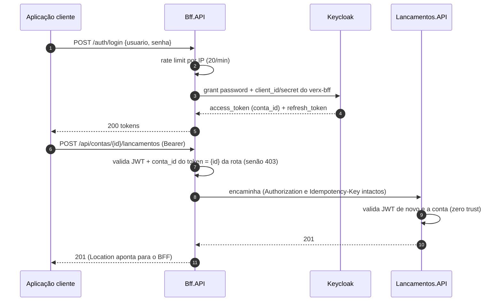
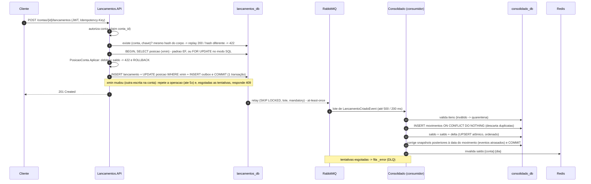
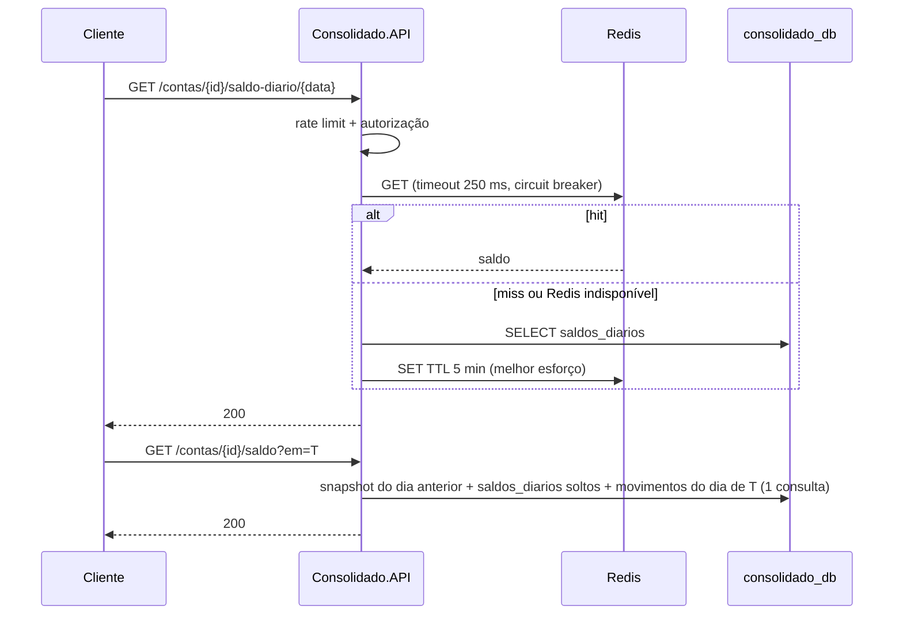

# Arquitetura — fluxos, falhas, requisitos não funcionais e ameaças

Complementa os [ADRs](adr/README.md) e os [diagramas C4](c4/01-contexto-e-containers.md).

## 0. Login e entrada única (BFF)

O cliente conhece **um** endereço e nunca fala com o Keycloak nem com os serviços internos ([ADR-0014](adr/0014-bff-ponto-unico-de-entrada.md)).
Os fluxos abaixo mostram os serviços; o BFF fica transparente entre o cliente e eles.

## 1. Fluxo de escrita e projeção

## 2. Fluxo de leitura

## 3. Modos de falha (o que o cliente percebe)

| Componente indisponível | `POST /lancamentos` | `GET /saldo*` | Recuperação |
|---|---|---|---|
| Bff.API | Falha (entrada única) | Falha | *Stateless*: várias réplicas atrás de um balanceador; probes `live` |
| Consolidado.API | OK | Falha (somente leitura) | Eventos acumulam no broker; projeção retoma sozinha |
| RabbitMQ | OK (Outbox) | OK (dado defasado) | Outbox entrega ao voltar |
| Redis | OK | OK (mais lento) | Circuit breaker fecha sozinho |
| PostgreSQL do Lançamentos | Falha (readiness = false) | OK | Failover do banco/réplica |
| PostgreSQL do Consolidado | OK | Falha | Consumidor pausa (circuit breaker) e retoma |
| Keycloak | OK enquanto o token for válido (JWKS em cache); **login/refresh falham com 503** em ≤ 8 s | idem | Circuit breaker no BFF; chaves JWKS são cacheadas pelo middleware |
| Lancamentos.API (visto do BFF) | `503` imediato após o health check marcar o destino fora (`502` na 1ª falha) | OK | Health check ativo reabilita sozinho |
| Pico / abuso | 429 | 429 | Token bucket repõe |
| Redis (rate limit e sessão do BFF) | OK (rate limit cai para o limite local da instância) | OK | Circuit breaker fecha sozinho; **logins por navegador falham** enquanto o Redis estiver fora (Bearer segue) |
| Débito sem saldo | `422` Saldo insuficiente (nada é gravado) | — | Cliente cobre o saldo ou estorna |

## 4. Requisitos não funcionais

| Requisito | Meta | Como é atendido |
|---|---|---|
| Disponibilidade da escrita | 99,9 % independente do consolidado | Isolamento + Outbox; réplicas stateless |
| Consistência | Nenhum lançamento perdido ou duplicado | Outbox + PK idempotente + acumulação atômica; DLQ |
| Latência de projeção | p99 < 5 s (medido: ~0 s a 800 req/s) | Relay com SKIP LOCKED + consumo em lote (ADR-0011/0012) |
| Desempenho de leitura | 50 req/s (pico) com perda ≤ 5 % | Cache, índice cobrindo, limitador global 500/s, escala horizontal |
| Segurança | Sem acesso entre contas | JWT completo + autorização por recurso, verificada no BFF **e** nos serviços |
| Superfície de ataque | Um endereço público | BFF único publicado; serviços na rede interna |
| Integridade financeira | Débito nunca excede o saldo | `PosicaoConta` com concorrência otimista (`xmin`) ou `FOR UPDATE` por conta, na mesma transação |
| Custo do saldo em um instante | Independente do histórico | Snapshots diários (ADR-0016) |
| Rate limit | Exato com N réplicas | Token bucket no Redis com fail-open local (ADR-0018) |
| Observabilidade | Rastreio ponta a ponta | OTel (traces/métricas), health, logs estruturados |
| Manutenibilidade | Evoluir sem regressão | Clean Architecture, testes, regras arquiteturais em CI, 0 warnings |

**Escala horizontal:** o BFF e as APIs de negócio são stateless (estado em PostgreSQL/Redis/RabbitMQ); réplicas do Consolidado competem pela
mesma fila (*competing consumers*), e a concorrência otimista garante a correção. O gargalo previsível é a contenção por
**(conta, dia)** — mitigável com upsert atômico (ADR-0004) ou particionamento por conta.

## 5. Modelo de ameaças (resumo STRIDE)

| Ameaça | Mitigação |
|---|---|
| **S**poofing — token forjado/de outro emissor | Validação de assinatura, emissor e audiência (BFF e serviços) |
| **S**poofing/força bruta no login | Rate limit **distribuído** por IP em `/auth/*`, client confidencial, Keycloak com lockout configurável |
| **S**ession hijacking / XSS roubando token | Navegador só tem cookie opaco `HttpOnly`; JWT e refresh token ficam no Redis (ADR-0017) |
| CSRF (cookie de sessão) | Mutações com cookie exigem `X-CSRF` ou `Sec-Fetch-Site: same-origin`; `SameSite=Lax`; logout por `POST` |
| *Open redirect* no login | `returnUrl` só é aceito se for local |
| Reuso malicioso/equivocado da `Idempotency-Key` | Hash do corpo: chave igual com corpo diferente = `422` (ADR-0015) |
| **T**ampering — alterar histórico | Ledger imutável; correção apenas por estorno; trilha `RegistradoPor` |
| **R**epudiation | `RegistradoPor` (sub) + `RegistradoEm` + traces |
| **I**nformation disclosure — BOLA/IDOR | Autorização por `conta_id` em toda rota; erros sem detalhes internos; sem PII nos serviços |
| **D**enial of service | Rate limit por usuário e global (distribuído na borda); backpressure no consumidor; timeouts |
| **E**levation of privilege | Menor privilégio (contêiner não-root); sem endpoints administrativos expostos |

## 6. Operação

- **Migrations:** aplicadas no startup com *retry/backoff* e lock do EF (conveniente para o desafio). Em produção, executar como
  etapa de deploy (Job) antes de subir as réplicas.
- **Alertas:** `MensagensNaDLQ` (DLQ > 0) já está configurado em [`prometheus-alerts.yml`](../prometheus-alerts.yml) (veja em http://localhost:9090/alerts). Sugeridos para produção: atraso de projeção > 5 s; taxa de 5xx; circuit breaker aberto; Outbox pendente crescendo.
- **Backup/RPO/RTO:** PostgreSQL com PITR (RPO ≈ minutos). O Consolidado é **reconstruível** a partir do ledger (reprojeção),
  portanto o ledger é o ativo crítico.
