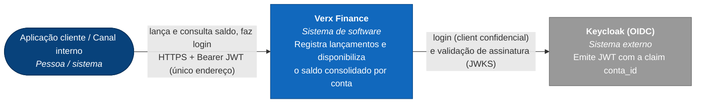
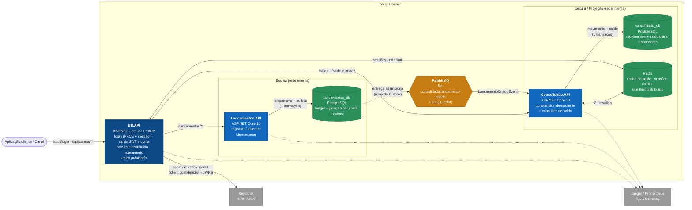

# C4 — Contexto e Containers

Diagramas como código (Mermaid, renderizados pelo GitHub). A mesma modelagem também está em
[`workspace.dsl`](workspace.dsl) (Structurizr DSL) para quem quiser gerar/explorar com o Structurizr Lite.

## Nível 1 — Contexto

## Nível 2 — Containers

**Decisões-chave**
- `Bff.API` é o **único container publicado** ao cliente ([ADR-0014](../adr/0014-bff-ponto-unico-de-entrada.md)): faz o login no Keycloak
  (o segredo do client fica no servidor), valida o JWT e a posse da conta e roteia para os serviços internos. Não tem regra de negócio.
- `Lancamentos.API` **não conhece** o `Consolidado.API` (nenhuma chamada síncrona entre eles). O único acoplamento é o contrato do
  evento em `Shared.Contracts`. Por isso a queda do consolidado, do RabbitMQ ou do Redis não derruba o registro de lançamentos
  (ver [ADR-0002](../adr/0002-transactional-outbox.md)).
