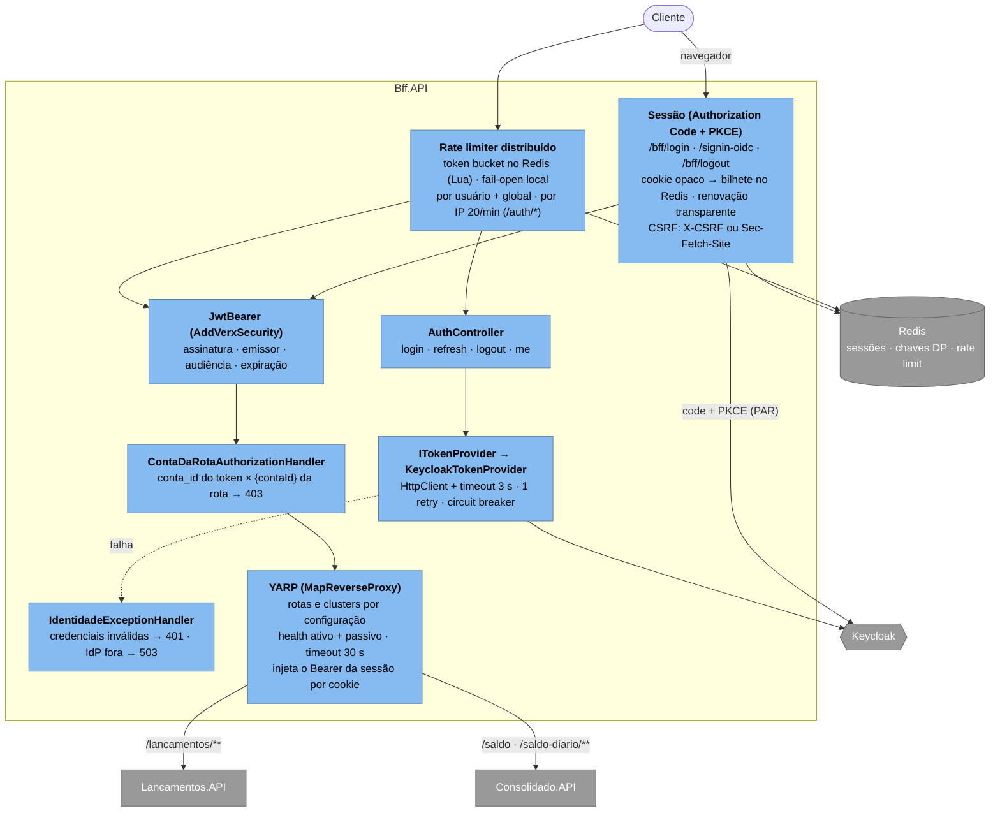
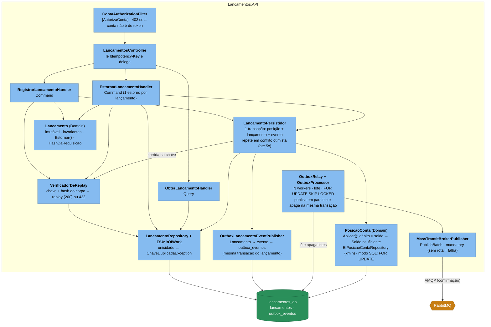
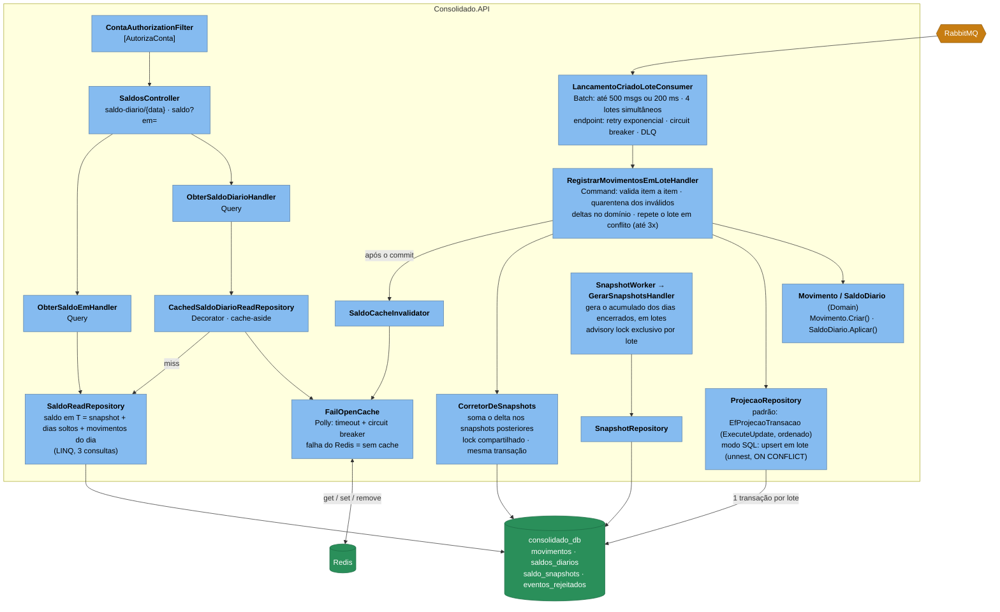

# C4 — Componentes (Nível 3)

## Bff.API (borda: login e gateway)



O contrato de rotas é guardado por `GatewayRotasTests` (cada endpoint dos serviços tem rota no BFF e vice-versa) e o BFF não pode
depender de `Lancamentos`, `Consolidado`, EF Core nem MassTransit (`BffArchitectureTests`).

## Lancamentos.API (lado de escrita)



## Consolidado.API (lado de leitura / projeção)



## Regra de dependência (verificada em CI)

```
API ──► Application ──► Domain ◄── (nada depende de Infrastructure, exceto a API para compor o DI)
            ▲
Infrastructure ┘   (implementa as portas definidas em Application/Domain)
```

Os testes em `src/Verx.ArchitectureTests` (NetArchTest) quebram o build se `Domain`/`Application`
passarem a depender de EF Core, MassTransit, ASP.NET, Redis ou dos contratos de eventos (`Shared.Contracts`),
ou se um contexto delimitado (`Lancamentos` ↔ `Consolidado`) referenciar o outro. O mapeamento
entidade → evento de integração acontece só na `Infrastructure`.
